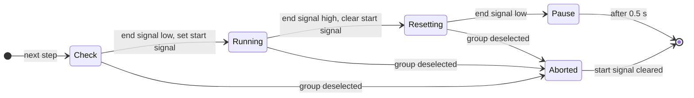
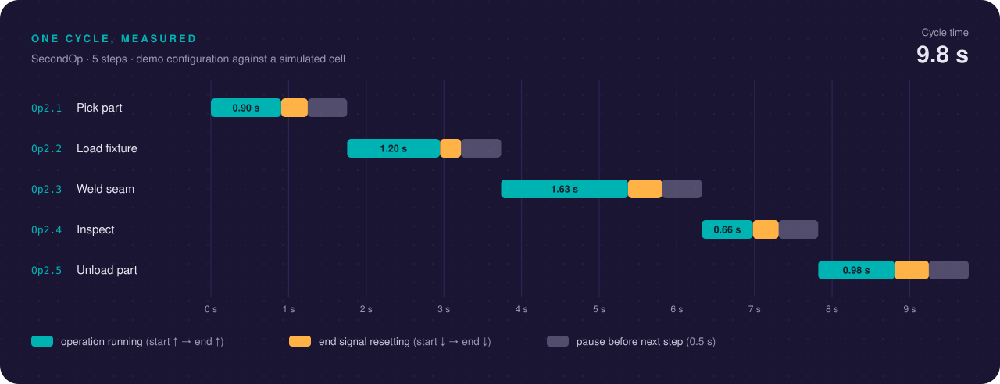

<div align="center">



<br>

<a href="#quick-start"></a>
<a href="server/README.md"></a>
<a href="client/README.md"></a>
<a href="process_simulate/README.md"></a>
<a href="LICENSE"></a>

<h3>Drive any Process Simulate study from outside the simulation.</h3>

Sequence operations with a strict start/end-signal handshake, stream robot joints in real time<br>
and control it all from Python, over plain OPC UA.

[How it works](#how-it-works) · [The handshake](#the-handshake) · [See it run](#see-it-run) · [Quick start](#quick-start) · [Adapt it](#adapt-it-to-your-study) · [Docs](#documentation)

</div>

<br>

<p align="center">
  
  <br>
  <sub>The control panel, shown with sample values.</sub>
</p>

## Why

Process Simulate is good at simulating a robot cell. Driving that simulation from the outside, to test a production sequence, try a control strategy or watch the robots from another application, usually needs a PLC program or a full virtual-commissioning setup.

This project is a lightweight alternative. It puts a small OPC UA server between Process Simulate and your own code, and provides the pieces to use it:

- **A signal bus.** An [open62541](https://www.open62541.org/) server holds start signals, end signals and joint angles. Process Simulate and every tool connect to it as OPC UA clients.
- **A sequencer.** A Python engine runs operations in order with a strict handshake, group arbitration and a safe shutdown.
- **A live view.** A .NET script streams 3 robots × 6 joints out of Process Simulate, and an operator panel shows them next to the sequence.

## Features

<table>
<tr>
<td width="33%" valign="top">
<br>
<b>Strict handshake</b><br>
Every step runs start ↑ → end ↑ → start ↓ → end ↓, with stale-signal checks and timeouts.
</td>
<td width="33%" valign="top">
<br>
<b>Group arbitration</b><br>
Four group controls pick what runs. The highest wins, switching groups aborts the current step, and every signal is reset on exit.
</td>
<td width="33%" valign="top">
<br>
<b>Live joints</b><br>
A Process Simulate script publishes 18 joint angles in degrees. Clients read them all in one batched request.
</td>
</tr>
<tr>
<td valign="top">
<br>
<b>Operator panel</b><br>
Build and start the server, run the sequencer, select a group and watch the joints from one window.
</td>
<td valign="top">
<br>
<b>Portable server</b><br>
One C executable and a JSON5 config. Copy the folder to any Windows PC and run it, no compiler needed.
</td>
<td valign="top">
<br>
<b>Per-machine identity</b><br>
One script writes the PC's hostname and IP into the config and generates a matching certificate.
</td>
</tr>
</table>

## How it works


1. **Process Simulate** connects to the server through an OPC UA external connection. Each operation waits for its start signal (`Trigger.*`) and raises its end signal (`Feedback.*`) when it finishes.
2. **The server** only stores values. It has no logic of its own, so any OPC UA client can read or write the same signals.
3. **The Python tools** make the decisions: the sequencer picks the next operation, the operator panel lets a person steer, and the joint reader watches the robots.

## The handshake

The sequencer never fires and forgets. Each step is a four-phase handshake, so it knows that the simulation started, finished and reset an operation before it moves on.




### Group arbitration

Steps are organised in up to four groups. Each group is selected by a boolean control, `Trigger.FirstOp` to `Trigger.FourthOp`:

- If several controls are on, the highest group wins and the sequencer switches the others off.
- Before every step the sequencer checks the selection again. If the active control drops during a step, the step is aborted and its start signal cleared.
- When the sequencer stops, it resets every start signal and group control to `false`.

## See it run

The sequencer running one cycle against a simulated cell, with a five-step demo configuration:


The same run as a timeline. Every bar is measured from the sequencer's log timestamps:



## Quick start

Windows PowerShell, from the repository root.

**1. Configure the server for this PC.** This writes the hostname and IP into `server/ps_server.json5` and generates a matching certificate.

```powershell
.\server\setup_new_pc.ps1
```

**2. Start the server.** It listens on `opc.tcp://<this-pc-ip>:4841`.

```powershell
.\server\run_server.bat
```

**3. Connect Process Simulate.** Point an OPC UA external connection at the endpoint, map your signals and run `BroadcastRobotJoints.cs` to stream joints. See [process_simulate/README.md](process_simulate/README.md).

**4. Run the Python tools.**

```powershell
py -m pip install -r requirements.txt
py client\opcua_control_app.py         # operator panel
py client\opcua_sequencer.py --once    # or one cycle from the command line
```

<details>
<summary>Script execution blocked?</summary>

Run `powershell -ExecutionPolicy Bypass -File .\server\setup_new_pc.ps1` instead.

</details>

## Adapt it to your study

The bundled signals are one example configuration. To drive your own cell:

1. **Name the signals.** In Process Simulate, give every operation a start signal and an end signal named after OPC UA nodes, for example `Trigger.Op1_1Start` and `Feedback.Pick_Part_end`, and map them through the OPC UA external connection.
2. **Expose them on the server.** Add one variable per signal to [server/server_json_config.c](server/server_json_config.c) and rebuild with `server\build.ps1`. See [server/README.md](server/README.md#add-or-change-variables).
3. **Describe the sequence.** List the steps of each group in `OPERATION_GROUPS` in [client/opcua_sequencer.py](client/opcua_sequencer.py):

   ```python
   OPERATION_GROUPS = {
       "FirstOp": [
           {"name": "Op1.1 - Pick part", "trigger": "Trigger.Op1_1Start", "feedback": "Feedback.Pick_Part_end"},
           {"name": "Op1.2 - Weld seam", "trigger": "Trigger.Op1_2Start", "feedback": "Feedback.Weld_Seam_end"},
       ],
       # ... up to four groups
   }
   ```

4. **Stream joints (optional).** Create the signals `PS.Robot1.j1` to `PS.Robot3.j6` and run `BroadcastRobotJoints.cs`.

## Repository layout

```text
.
├── server/              OPC UA server: C source, config, build and setup scripts, portable runtime
├── client/              Python tools: operator panel, sequencer, joint reader
├── process_simulate/
│   ├── scripts/         .NET scripts to run inside Process Simulate
│   └── studies/         Your Process Simulate study (.psz, git-ignored)
├── docs/                Architecture and deployment guides, README graphics
├── third_party/         open62541 version notes and local patches
├── legacy/              Earlier versions, kept for reference
└── requirements.txt     Python dependencies
```

## Documentation

| Topic | Document |
|---|---|
| Components, data flow, address space, handshake | [docs/architecture.md](docs/architecture.md) |
| Running, building and extending the server | [server/README.md](server/README.md) |
| Moving the server to another PC | [docs/deployment.md](docs/deployment.md) |
| Operator panel, sequencer and joint reader | [client/README.md](client/README.md) |
| Process Simulate scripts | [process_simulate/README.md](process_simulate/README.md) |
| open62541 version and local patches | [third_party/README.md](third_party/README.md) |

## Requirements

| To | You need |
|---|---|
| Run the server | Windows and TCP port 4841. The OpenSSL DLLs ship in `server/`. |
| Generate certificates | Python 3.7+ with `cryptography` |
| Run the Python tools | Python 3 with the packages in [requirements.txt](requirements.txt) |
| Rebuild the server | Visual Studio 2022 Build Tools (C++), CMake, OpenSSL and the open62541 source |

## Security

This is a tool for trusted lab and engineering networks.

- The prebuilt server is compiled without encryption, so only the `None` security policy is active and the other policies in `ps_server.json5` are ignored. Anonymous access is enabled and every variable is writable.
- Certificates and private keys are machine-specific and git-ignored. Generate them on each PC with `server/setup_new_pc.ps1`.

See [SECURITY.md](SECURITY.md) for hardening tips and how to report a vulnerability.

## Roadmap

- [ ] Load nodes and operation groups from one config file instead of C code and Python constants
- [ ] Build the server with OpenSSL encryption (`-DUA_ENABLE_ENCRYPTION=OPENSSL`) so the configured security policies take effect
- [ ] Clear a step's start signal when the step times out
- [ ] Strip ANSI colour codes from sequencer output in the operator-panel log
- [ ] Ship the sequencer as its own EXE (the operator panel already looks for `client/opcua_sequencer.exe`)

## Contributing

Issues and pull requests are welcome. [CONTRIBUTING.md](CONTRIBUTING.md) covers the setup and the checks to run.

## License

[MIT](LICENSE). Third-party components keep their own licenses; see [THIRD_PARTY_NOTICES.md](THIRD_PARTY_NOTICES.md).

Built with [open62541](https://www.open62541.org/) and [asyncua](https://github.com/FreeOpcUa/opcua-asyncio).

<sub>This is an independent project, not affiliated with or endorsed by Siemens. Siemens, Tecnomatix and Process Simulate are trademarks of Siemens or its affiliates.</sub>
