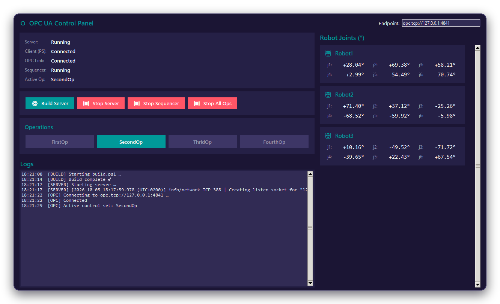

# Python tools

Three OPC UA clients built on [asyncua](https://github.com/FreeOpcUa/opcua-asyncio). Install the dependencies once from the repository root:

```powershell
py -m pip install -r requirements.txt
```

All tools default to `opc.tcp://127.0.0.1:4841`. Pass `--url`, or edit the endpoint field in the panel, to use another server.

## Operator panel: `opcua_control_app.py`



A Tkinter window to:

- build the server (`server/build.ps1`), start and stop it, and see when a client connects (parsed from the server's console output),
- start and stop the sequencer,
- select an operation group (`FirstOp` … `FourthOp`) or switch all of them off,
- watch the joints of Robot1 to Robot3 (j1 to j6, in degrees).

```powershell
py client\opcua_control_app.py
```

The panel finds the project by walking up from its own folder until it finds `server/`. If that fails it asks for the folder. You can also set it explicitly:

| Variable | Purpose |
|---|---|
| `TESTOPC_ROOT` | Project root, the folder that contains `server/` and `client/` |
| `OPCUA_PYTHON_EXE` | Python interpreter used to start the sequencer when the panel runs as an EXE |

The sequencer runs as a separate process: `client/opcua_sequencer.exe` if it exists, otherwise `client/opcua_sequencer.py` with the current Python (from the packaged EXE: `OPCUA_PYTHON_EXE`, `python` or `py` on `PATH`, or a standard install folder).

### Package as an EXE

From the repository root:

```powershell
py -m PyInstaller client\opcua_control_app.spec
```

This builds a single-file, windowed `dist\opcua_control_app.exe` (git-ignored). Keep the EXE inside the project folder, for example in `dist\`, so it can find `server/` and `client/`, or set `TESTOPC_ROOT`.

## Sequencer: `opcua_sequencer.py`

Runs the steps of the active operation group in order, using the start/end-signal handshake described in [docs/architecture.md](../docs/architecture.md#step-handshake).



```powershell
py client\opcua_sequencer.py --url opc.tcp://192.168.0.10:4841 --cycles 100
```

| Option | Meaning |
|---|---|
| `--url` | Server endpoint |
| `--cycles N` | Run N cycles; omit to loop until stopped |
| `--once` | Run one cycle of the active group and exit |
| `--dry-run` | Log the writes to start signals and group controls without performing them |

A cycle starts only when one of the group controls `Trigger.FirstOp` … `Trigger.FourthOp` is `true`. Set it from the operator panel or any OPC UA client.

### Configure your steps

The steps live in `OPERATION_GROUPS` at the top of the file. Each step names the start signal the sequencer sets and the end signal it waits for:

```python
OPERATION_GROUPS = {
    "FirstOp": [
        {"name": "Op1.1 - Pick part", "trigger": "Trigger.Op1_1Start", "feedback": "Feedback.Pick_Part_end"},
        {"name": "Op1.2 - Weld seam", "trigger": "Trigger.Op1_2Start", "feedback": "Feedback.Weld_Seam_end"},
    ],
    # ... up to four groups
}
```

Timeouts and delays are constants next to it: `OPERATION_TIMEOUT` (60 s), `FEEDBACK_RESET_TIMEOUT` (30 s), `INTER_OPERATION_DELAY` (0.5 s), `INTER_CYCLE_DELAY` (0.5 s) and `SIGNAL_READ_INTERVAL` (0.1 s).

## Joint reader: `read_joints.py`

Reads all 18 joints (`PS.Robot1.j1` … `PS.Robot3.j6`) in one batched request and prints them with the read time.

```powershell
py client\read_joints.py --url opc.tcp://192.168.0.10:4841 --interval 0.5
```

| Option | Meaning |
|---|---|
| `--url` | Server endpoint |
| `--interval S` | Seconds between reads (default 0.05; 0 reads as fast as possible) |
| `--once` | Read once and exit |
