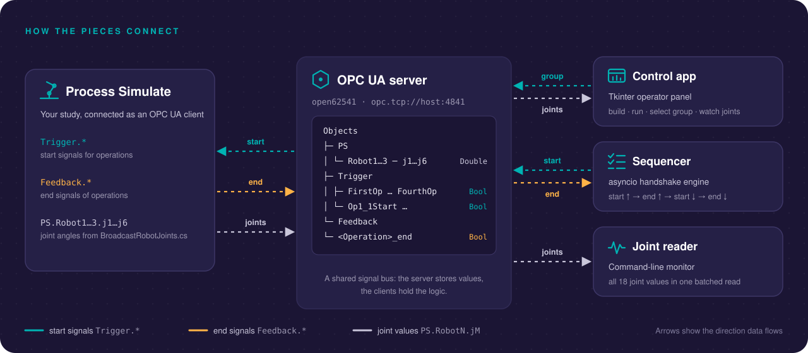
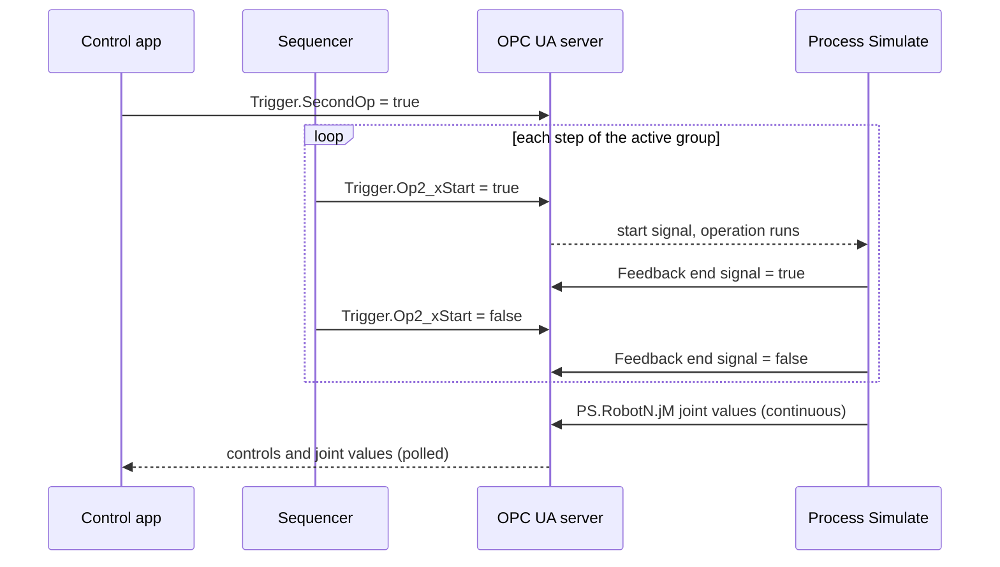

# Architecture



## Components

| Component | Location | Role |
|---|---|---|
| OPC UA server | [server/server_json_config.c](../server/server_json_config.c) | open62541 server. Reads endpoint and security settings from `ps_server.json5` and creates the address space below. |
| Process Simulate | [process_simulate/](../process_simulate/) | Runs the robot cell. Uses `Trigger.*` values as operation start signals, writes `Feedback.*` end signals and, through `BroadcastRobotJoints.cs`, joint values. |
| Sequencer | [client/opcua_sequencer.py](../client/opcua_sequencer.py) | Runs the steps of the selected operation group in order: sets a start signal, waits for the end signal, resets. |
| Control app | [client/opcua_control_app.py](../client/opcua_control_app.py) | Tkinter GUI. Builds, starts and stops the server, starts and stops the sequencer, selects the operation group and shows joint values. |
| Joint reader | [client/read_joints.py](../client/read_joints.py) | Command-line reader for the 18 joint values. |

All of them except the server are OPC UA clients. The server only stores the values.

## Data flow



## Address space

All nodes are in namespace 1 and use string NodeIds equal to their dotted path, for example `ns=1;s=Trigger.FirstOp` or `ns=1;s=PS.Robot2.j4`. Every variable is readable and writable.

```text
Objects
├── PS
│   ├── Robot1        j1 … j6    Double, degrees
│   ├── Robot2        j1 … j6    Double, degrees
│   └── Robot3        j1 … j6    Double, degrees
├── Trigger                      Boolean, initially false
│   ├── FirstOp … FourthOp       operation group selection
│   └── Op<g>_<n>Start           start signal of step n in group g
└── Feedback                     Boolean, initially false
    └── <Operation>_end          end signal of an operation
```

End-signal nodes are named after the operation's end signal in Process Simulate, for example `Feedback.Pick_Part_end`. The exact set of nodes is defined in [server/server_json_config.c](../server/server_json_config.c).

The third group control is spelled `ThridOp` in the server, the sequencer and the control app. If you rename it, change all three.

## Operation groups

The four group controls `Trigger.FirstOp` … `Trigger.FourthOp` select which group the sequencer runs. If more than one is `true`, the highest wins (fourth, then third, second, first) and the sequencer sets the others to `false`.

Each group is an ordered list of steps. A step pairs a start signal with the end signal of the operation it starts:

| Group | Step | Start signal | End signal |
|---|---|---|---|
| SecondOp | Op2.1 - Pick part | `Trigger.Op2_1Start` | `Feedback.Pick_Part_end` |
| | Op2.2 - Load fixture | `Trigger.Op2_2Start` | `Feedback.Load_Fixture_end` |
| | Op2.3 - Weld seam | `Trigger.Op2_3Start` | `Feedback.Weld_Seam_end` |

The table shows an illustrative configuration. The steps are defined in `OPERATION_GROUPS` in [client/opcua_sequencer.py](../client/opcua_sequencer.py) and the nodes in [server/server_json_config.c](../server/server_json_config.c); keep the two in sync.

## Step handshake



For each step the sequencer:

1. waits for the end signal to be `false` if it is still `true` from an earlier run (timeout 30 s),
2. sets the start signal to `true`,
3. waits for the end signal to become `true` (timeout 60 s),
4. sets the start signal to `false`,
5. waits for the end signal to return to `false` (timeout 30 s),
6. pauses 0.5 s before the next step.

If the active group control turns `false` during a step (the control app does this when you select another group), the sequencer stops the step and clears its start signal. When it stops, it sets every start signal and group control to `false`.

In continuous mode a step that times out is logged and the sequencer moves on to the next step. Its start signal currently stays set until the next cycle or exit.

## Endpoint and security

- `server/ps_server.json5` defines the application URI, the endpoint URLs (port 4841) and four security policies: None, Basic256Sha256, Aes128_Sha256_RsaOaep and Aes256_Sha256_RsaPss.
- The prebuilt `server_json_config.exe` is compiled without encryption support. It ignores the `securityPolicies` and `pkiFolder` fields (it logs `Field name 'securityPolicies' unknown`) and offers only the `None` policy. To enable the others, configure open62541 with `-DUA_ENABLE_ENCRYPTION=OPENSSL` and rebuild.
- Anonymous access is enabled and every variable is writable.
- The certificate, key and PKI paths are relative, so the server must be started from `server/`. `run_server.bat` and the control app do this.
- The certificate embeds the application URI, hostname and IP. `server/setup_new_pc.ps1` updates the config and regenerates the certificate together.
- `server/open62541_pki/` is the server's certificate trust store. open62541 creates the folders on start.
